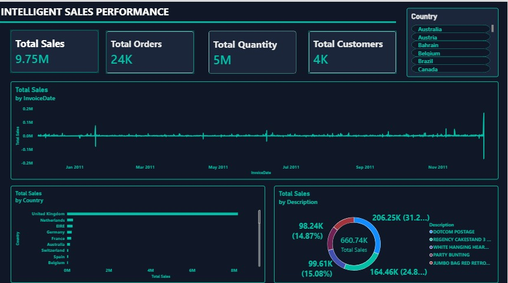
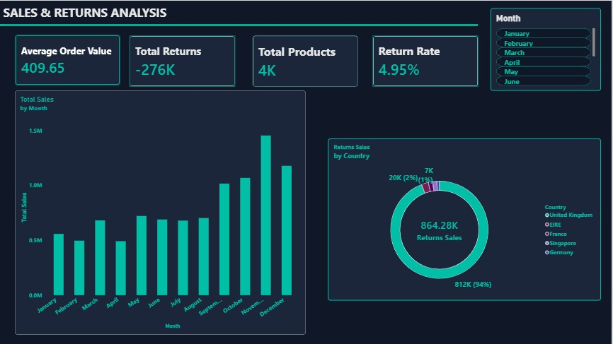
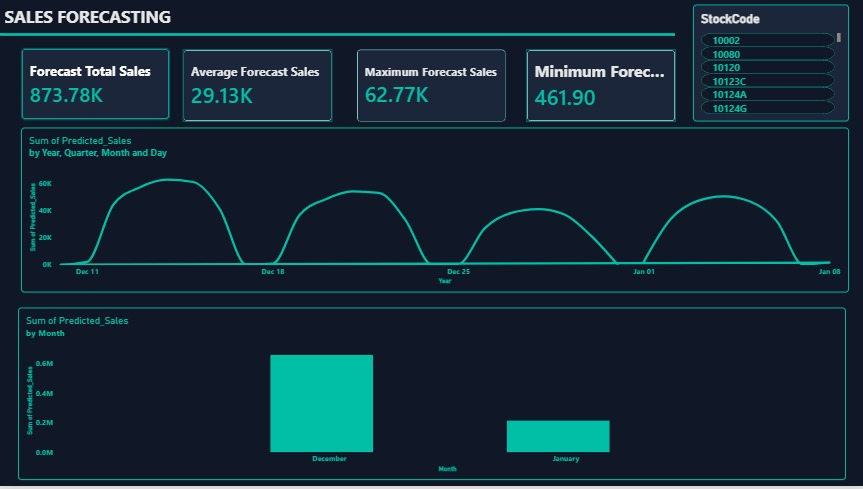
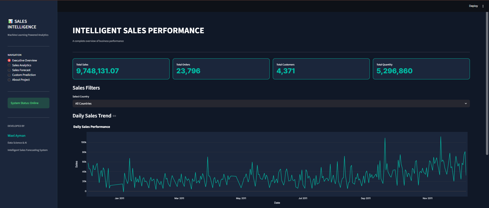
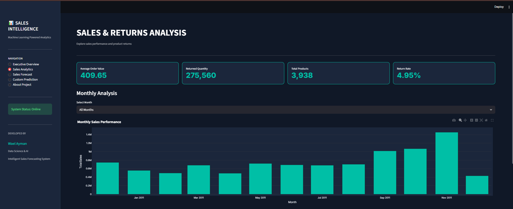
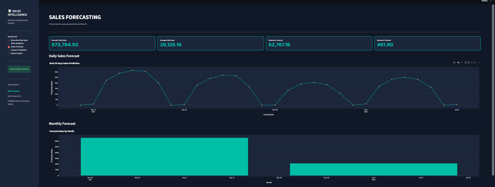
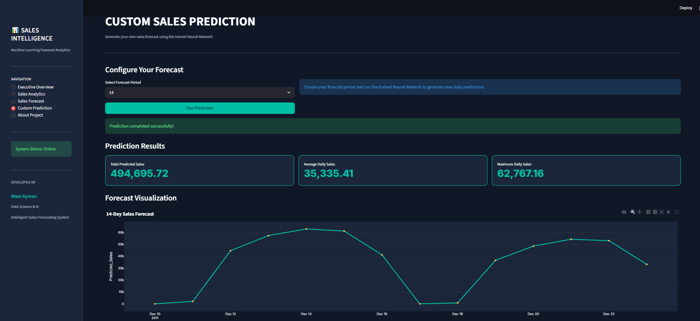

# 📊 Intelligent Sales Forecasting System

### End-to-End Data Science, Machine Learning & Business Intelligence Project

An intelligent sales analytics and forecasting system that transforms historical retail data into meaningful business insights and future sales predictions using Machine Learning, Power BI, and Streamlit.

---

## 📌 Project Overview

The **Intelligent Sales Forecasting System** is an end-to-end Data Science project built to analyze historical retail transactions, understand sales performance, identify business trends, analyze product returns, and predict future sales.

The project combines data analysis, machine learning, business intelligence, and an interactive web application into one integrated solution.

### 🎯 Project Objectives

- Analyze historical retail sales data.
- Perform data cleaning and preprocessing.
- Explore sales patterns and business trends.
- Build and evaluate multiple Machine Learning models.
- Predict future sales using a Neural Network.
- Create interactive Power BI dashboards.
- Develop a Streamlit application for sales analytics and custom predictions.

---

# 📸 Project Screenshots

## 1. Power BI Dashboard

### Sales Overview



### Sales & Returns Analysis



### Sales Forecast



---

## 2. Streamlit Web Application

### Executive Overview



### Sales Analytics



### Sales Forecast



### Custom Sales Prediction



---

# 🧹 Data Preparation & Analysis

The project uses the **Online Retail Dataset**.

The original dataset contains 541,909 transaction records and 8 columns.

Data preprocessing included:

- Removing duplicate records.
- Handling missing product descriptions.
- Checking invalid and zero unit prices.
- Handling missing customer information.
- Preserving negative quantities to represent returns.
- Creating a new `TotalSales` feature.

The cleaned sales dataset contains 534,129 records after filtering out invalid and zero unit-price transactions.

### Exploratory Data Analysis (EDA)

The analysis included:

- Monthly Sales Analysis.
- Daily Sales Trends.
- Sales Distribution by Country.
- Product Performance Analysis.
- Returns Analysis.
- Time Series Analysis.

---

# 🤖 Machine Learning Models

Four regression models were trained and evaluated:

1. Linear Regression
2. Random Forest Regressor
3. Neural Network (MLPRegressor)
4. XGBoost Regressor

### Model Evaluation

The models were evaluated using:

- **MAE:** Mean Absolute Error
- **RMSE:** Root Mean Squared Error
- **R² Score:** Coefficient of Determination

| Model | MAE | RMSE | R² |
|---|---:|---:|---:|
| Linear Regression | 12,898.36 | 16,638.77 | 0.511 |
| Random Forest | Approx. 12,457 | Approx. 17,553 | 0.456 |
| Neural Network | 11,972.56 | 16,224.46 | 0.535 |
| XGBoost | 14,325 | 19,920 | 0.299 |

**Best Performing Model:** Neural Network (MLPRegressor)

The Neural Network achieved the best overall performance among the evaluated models, with the lowest MAE and RMSE and the highest R² score.

*Note: Random Forest error values are approximate. The evaluation uses a chronological train-test split and rolling one-step-ahead test features, where actual previous sales values are available for lag features. These metrics should not be interpreted as fixed 72-day forecasting accuracy.*

---

# 🔮 Sales Forecasting

The selected Neural Network model uses engineered time-series features to generate future sales predictions.

### Feature Engineering

The model uses the following features:

- Lag_1
- Lag_7
- Lag_14
- DayOfWeek
- Month
- DayOfMonth
- IsWeekend
- Rolling_Mean_7
- Rolling_Std_7

### Forecasting Features

- 30-day future sales forecasting.
- Recursive daily predictions.
- Custom forecasting for 7, 14, and 30 days.
- Forecast visualization.
- Downloadable prediction results.

**Important Assumption:** Saturday sales are assumed to be zero based on the observed historical dataset. This is an assumption derived from the data and not independent confirmation that the business is closed every Saturday.

Forecasts are estimates and should be interpreted with caution, especially over longer recursive forecasting periods.

---

# 📊 Power BI Dashboard

The Power BI dashboard contains three interactive pages:

### 1. Sales Overview
- Total Sales
- Total Orders
- Total Customers
- Total Quantity
- Daily Sales Trend
- Sales by Country
- Top 5 Products

### 2. Sales & Returns Analysis
- Average Order Value
- Total Returns
- Total Products
- Return Rate
- Monthly Sales Performance
- Returns by Country

### 3. Sales Forecast
- Forecast Total Sales
- Average Forecast Sales
- Maximum Forecast Sales
- Minimum Positive Forecast Sales
- Daily Forecast Trend
- Monthly Forecast Analysis

---

# 🌐 Streamlit Web Application

The Streamlit application provides an interactive interface with five main sections:

| Page | Description |
|---|---|
| Executive Overview | Overall sales performance and country filtering |
| Sales Analytics | Monthly sales and returns analysis |
| Sales Forecast | Future sales forecast and visualization |
| Custom Prediction | Generate 7, 14, or 30-day predictions |
| About Project | Project information and technologies |

---

# 🛠️ Technologies Used

### Programming & Data Analysis
- Python
- Pandas
- NumPy
- Jupyter Notebook

### Machine Learning
- Scikit-learn
- XGBoost
- Joblib

### Data Visualization
- Plotly
- Power BI

### Web Application
- Streamlit

### Development Tools
- Visual Studio Code
- Git & GitHub

---

# 📂 Project Structure

```text
Intelligent-Sales-Forecasting/
│
├── app.py
├── Notebook.ipynb
│
├── best_sales_model.pkl
├── cleaned_sales_data.csv
├── future_forecast.csv
│
├── requirements.txt
├── README.md
├── .gitignore
│
├── data/
│
└── screenshots/
    ├── sales_overview.jpeg
    ├── sales_analysis.jpeg
    ├── sales_forecast.jpeg
    ├── streamlit_overview.png
    ├── streamlit_analytics.png
    ├── streamlit_forecast.png
    └── custom_prediction.png
```

---

# ⚙️ Installation & Usage

Follow these steps to run the project locally.

### 1. Clone the Repository

```bash
git clone https://github.com/waelwael754/Intelligent-Sales-Forecasting.git
```

### 2. Navigate to the Project Folder

```bash
cd Intelligent-Sales-Forecasting
```

### 3. Create a Virtual Environment (Optional)

```bash
python -m venv venv
```

Activate it on Windows:

```bash
venv\Scripts\activate
```

### 4. Install Dependencies

```bash
pip install -r requirements.txt
```

### 5. Run the Streamlit Application

```bash
python -m streamlit run app.py
```

The application will open in your browser at:

```text
http://localhost:8501
```

---

# 📁 Required Project Files

Make sure the following files are available in the project directory:

- `app.py`
- `best_sales_model.pkl`
- `cleaned_sales_data.csv`
- `future_forecast.csv`
- `requirements.txt`

The application uses these files to load the trained model, historical sales data, and forecast results.

---

# 👨‍💻 Developer

**Wael Ayman**

Data Science & Artificial Intelligence

GitHub: [@waelwael754](https://github.com/waelwael754)

---

## ⭐ Acknowledgment

This project represents an end-to-end application of Data Science, Machine Learning, and Business Intelligence techniques to a real-world retail sales forecasting problem.

If you find this project interesting, feel free to explore the repository and give it a star!
